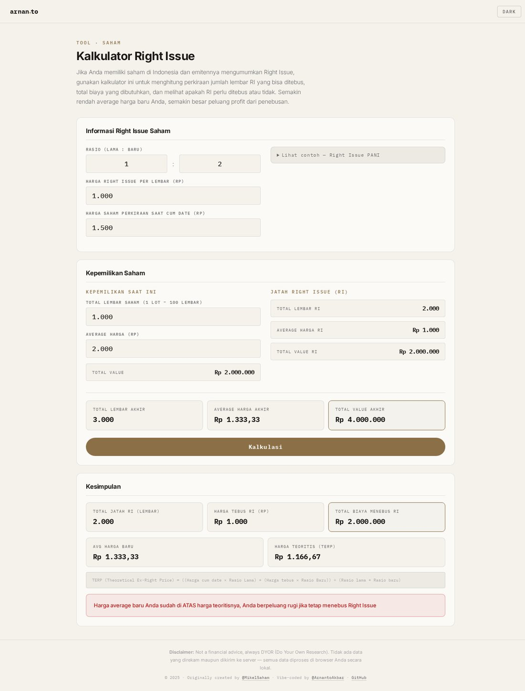
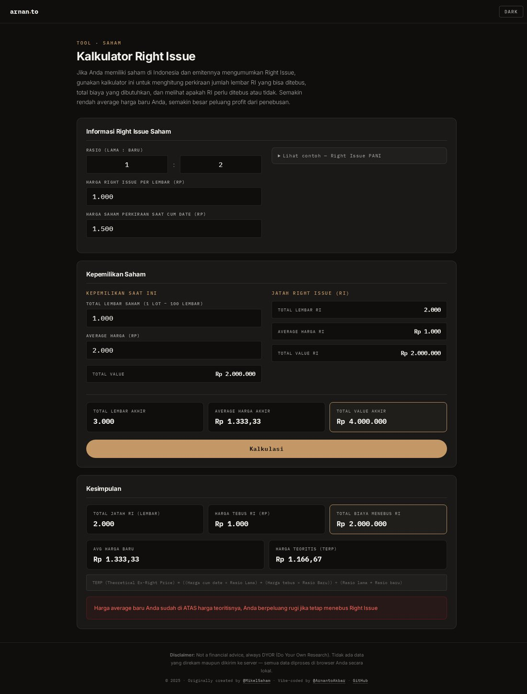

# Kalkulator Right Issue

Aplikasi web untuk menghitung potensi keuntungan dan biaya penebusan **Right Issue (RI)** saham di Indonesia. Didesain ulang dengan **Arnanto Design System** — paper/snow surfaces, walnut accent, IBM Plex Mono labels, light/dark mode.

**Live di:** <https://arnan.to/right-issue/>





## Fitur

- **Kalkulasi Otomatis** — menghitung jumlah lembar baru (jatah RI), total biaya tebus, average harga baru, dan harga teoritis (TERP).
- **Rekomendasi Cerdas** — saran otomatis tebus/tidak berdasarkan perbandingan average harga baru dengan harga teoritis.
- **Mode Gelap/Terang** — tema tersimpan di `localStorage` (`arnanto.theme`), sinkron dengan tool Arnanto lainnya.
- **Mobile-first** — layout responsif untuk desktop maupun perangkat mobile.
- **Privasi Terjamin** — semua perhitungan diproses lokal di browser. Tidak ada data yang dikirim ke server.

## Cara Menggunakan

1. **Buka aplikasi**: <https://arnan.to/right-issue/>
2. **Masukkan data Right Issue**:
   - **Rasio (Lama : Baru)** — rasio HMETD (mis. `1 : 2`).
   - **Harga Right Issue** — harga pelaksanaan (exercise price) per lembar.
   - **Harga Cum Date** — perkiraan harga saham saat cum date.
3. **Masukkan data kepemilikan**:
   - **Total Lembar Saham** — jumlah saham yang dimiliki (1 lot = 100 lembar).
   - **Average Harga** — harga rata-rata pembelian saham saat ini.
4. Klik **Kalkulasi**.
5. Lihat hasil di **Kesimpulan** dan rekomendasi tebus/tidak.

Referensi contoh tersedia di dalam aplikasi (Right Issue PANI) — klik "Lihat contoh".

## Rumus

**TERP (Theoretical Ex-Right Price):**

```
TERP = ((Harga cum date × Rasio Lama) + (Harga tebus × Rasio Baru)) ÷ (Rasio Lama + Rasio Baru)
```

Rekomendasi:

- `Average harga baru < TERP` → masih berpeluang untung jika menebus RI.
- `Average harga baru ≥ TERP` → berpeluang rugi jika tetap menebus RI.

## Teknologi

- HTML5 + CSS3 + JavaScript (Vanilla) — **single file** `index.html`, tanpa build step.
- Arnanto Design System (tokens, typography Inter + IBM Plex Mono).
- Font: Google Fonts (Inter, IBM Plex Mono).

## Struktur

```
index.html          — aplikasi lengkap (HTML + CSS + JS inline)
contoh.jpg          — contoh kasus Right Issue PANI
screenshots/        — tangkapan layar (light & dark mode)
```

> Catatan: versi lama (`script.js`, `style.css`) digabung ke dalam `index.html` pada desain ulang ini. Diperbaiki juga bug: elemen `#conclusion-ratio` yang direferensikan `script.js` tapi tidak ada di HTML — sebelumnya menyebabkan error saat input rasio.

## Kredit

- **Vibe-coded by**: [@ArnantoAkbar](https://x.com/ArnantoAkbar)
- **Originally created by**: [@MikelSaham](https://x.com/mikelsaham)

## Lisensi

Project ini bersifat open-source dan bebas digunakan untuk keperluan pribadi.

---

**Disclaimer:** Bukan financial advice, selalu DYOR (Do Your Own Research).
